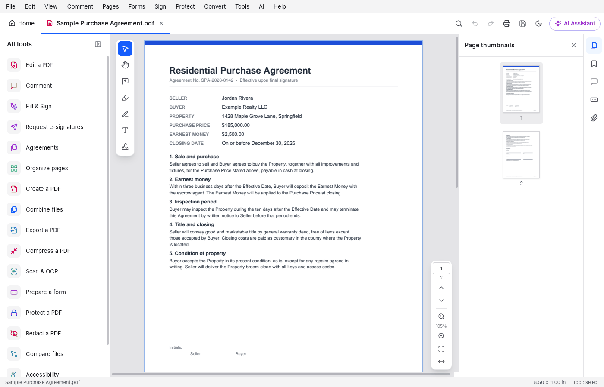
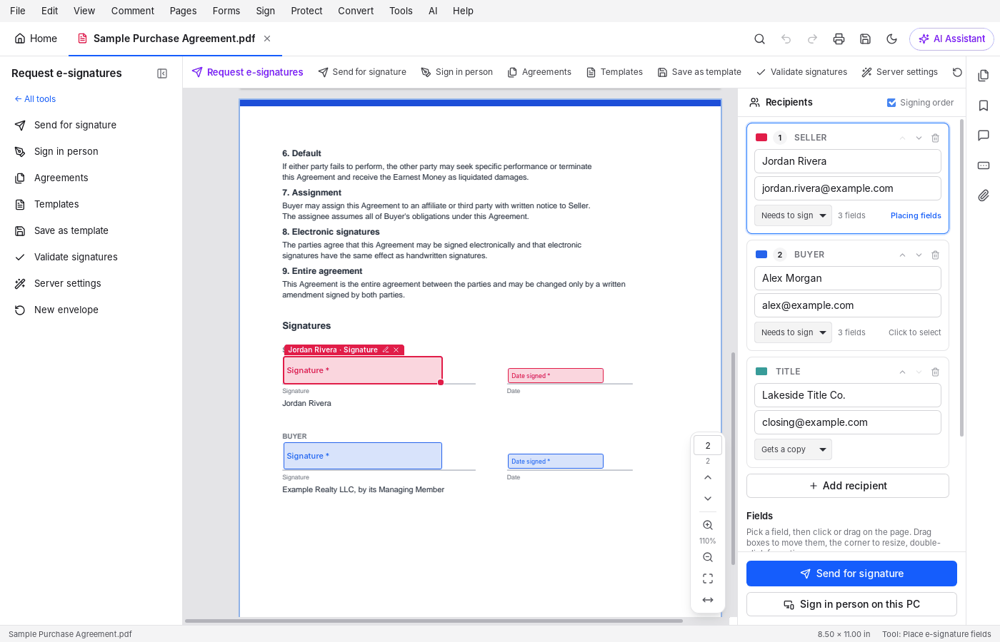
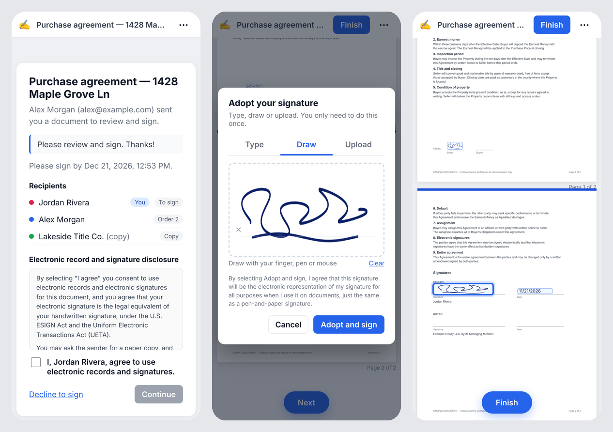
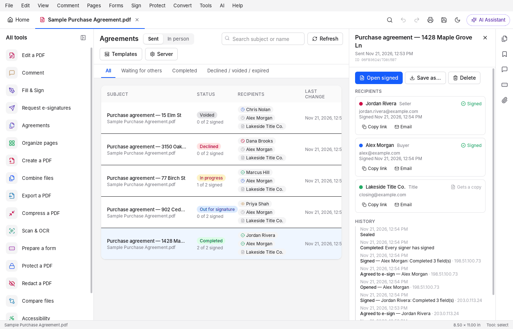
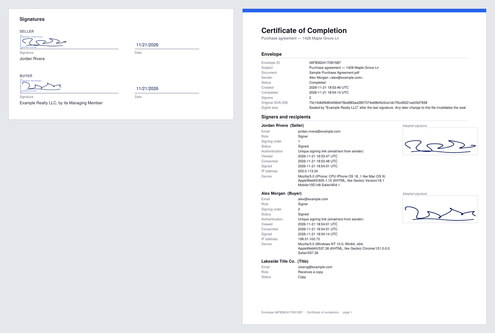

# PDF Sign Office

A desktop PDF editor for Windows and Linux: view, comment, edit, fill and sign forms, organize pages, convert, OCR, protect and redact. Tools are grouped by task, so everything is easy to find.

[](https://www.microsoft.com/windows)
[](#linux)



## Contents

- [Install PDF Sign Office](#install-pdf-sign-office)
  - [Windows](#windows)
  - [Linux](#linux)
  - [Optional add-ons](#optional-add-ons)
  - [Updating](#updating) · [Uninstalling](#uninstalling)
- [Install the signing server (Docker)](#install-the-signing-server-docker)
- [Using e-signatures](#using-e-signatures)
  - [Screenshots](#screenshots)
  - [The digital seal](#the-digital-seal) · [Trusted seal with a cloud-signing certificate](#trusted-seal-with-a-cloud-signing-certificate) · [Legal note](#legal-note)
- [Layout](#layout)
- [Features](#features)
- [Not included](#not-included) · [Known limits](#known-limits)
- [Pricing and licenses](#pricing-and-licenses) · [License](#license)
- [Support](#support)

## Install PDF Sign Office

### Windows

1. Open the [latest release](https://github.com/g-nit/pdf-sign-office/releases/latest).
2. Download **one** of these:
   - **`PDF.Sign.Office_x.x.x_x64-setup.exe`**: the standard installer. This is the right choice for most people. You can install it just for yourself, with no admin rights needed, or for all users.
   - **`PDF.Sign.Office_x.x.x_x64_en-US.msi`**: for IT departments or deployment through Group Policy/Intune.
3. Run the file and follow the prompts.
4. Open **PDF Sign Office** from the Start menu.

**"Windows protected your PC" warning:** the installer isn't code-signed yet, so SmartScreen may show this warning. Click **More info ▸ Run anyway**.

**WebView2:** PDF Sign Office uses Microsoft Edge WebView2, which Windows 10 and 11 already include. If it's missing, the installer downloads it automatically, which needs an internet connection.

**Open PDFs with PDF Sign Office by default:** the installer registers PDF Sign Office for `.pdf` files. To make it the default, right-click any PDF ▸ **Open with ▸ Choose another app ▸ PDF Sign Office ▸ Always**.

### Linux

Every release has Linux packages for **x86-64** (most PCs and laptops) and **ARM64** (Raspberry Pi 4/5 on a 64-bit OS, ARM laptops and servers). They work on Ubuntu 22.04, Debian 12, Fedora 36 and newer, and their derivatives (Linux Mint, Pop!_OS, elementary, Zorin, RHEL/Rocky/Alma 9, openSUSE…).

From the [latest release](https://github.com/g-nit/pdf-sign-office/releases/latest), download the one that fits your system:

| Package | For | Install |
|---|---|---|
| `PDF.Sign.Office_x.x.x_amd64.deb` / `_arm64.deb` | Ubuntu, Debian, Mint, Pop!_OS… | `sudo apt install ./PDF.Sign.Office_*_amd64.deb` |
| `PDF.Sign.Office-x.x.x-1.x86_64.rpm` / `.aarch64.rpm` | Fedora, RHEL, Rocky, Alma, openSUSE | `sudo dnf install ./PDF.Sign.Office-*.x86_64.rpm` (openSUSE: `sudo zypper install …`) |
| `PDF.Sign.Office_x.x.x_amd64.AppImage` / `_aarch64.AppImage` | Any distribution, no install | `chmod +x PDF.Sign.Office_*.AppImage`, then double-click it or run it |

The `.deb` and `.rpm` packages add **PDF Sign Office** to your applications menu and register it for PDF files. To make it the default, right-click a PDF ▸ **Open With ▸ PDF Sign Office** and choose to always use it, or run `xdg-mime default pdf-sign-office.desktop application/pdf`.

**If the AppImage doesn't start:** install FUSE 2. On Ubuntu 24.04 that's `sudo apt install libfuse2t64`; on Ubuntu 22.04 and Debian it's `sudo apt install libfuse2`. You can also run it with `--appimage-extract-and-run`.

Your settings and data are stored in `~/.local/share/com.pdfstudio.app`.

### Optional add-ons

These are only needed for the features listed. Everything else works without them.

| Feature | What to install |
|---|---|
| OCR (Scan & OCR, searchable scans) | [Tesseract for Windows](https://github.com/UB-Mannheim/tesseract/wiki). Use the default install folder (`C:\Program Files\Tesseract-OCR`) and PDF Sign Office finds it automatically. If it's installed somewhere else, set the `TESSERACT_PATH` environment variable to the full path of `tesseract.exe`. |
| OCR on Linux | `sudo apt install tesseract-ocr` (Fedora: `sudo dnf install tesseract`). Add other languages with packages such as `tesseract-ocr-spa`. |
| Create PDF from Word / Excel / PowerPoint | Microsoft Office, or the free [LibreOffice](https://www.libreoffice.org/download/). On Linux: `sudo apt install libreoffice` (or `dnf`). |
| Read aloud on Linux | Usually already installed. If not: `sudo apt install speech-dispatcher` or `espeak-ng`. |
| AI Assistant | An [Anthropic API key](https://console.anthropic.com/). In the app, open **AI ▸ Settings / API key…** and paste it in. The key is stored only on your PC. |

### Updating

Download the newer installer or package from Releases and install it the same way. On Linux, replace the AppImage file. It upgrades the existing install in place, and your settings, recent files, signatures and stamps are kept.

### Uninstalling

- **Windows:** go to **Settings ▸ Apps ▸ Installed apps ▸ PDF Sign Office ▸ Uninstall**. Your saved data stays in `%APPDATA%\com.pdfstudio.app`. Delete that folder too if you want to remove everything.
- **Linux:** run `sudo apt remove pdf-sign-office` or `sudo dnf remove pdf-sign-office`, or delete the AppImage. Your data is in `~/.local/share/com.pdfstudio.app`.

## Install the signing server (Docker)

The signing server is only needed to **send documents for e-signature** to people outside your computer. PDF Sign Office itself works without it, and so does in-person signing.

Remote signing needs a small server that signers can reach from the internet. It's a Docker container, so it runs on almost anything that has Docker:
- a home server or NAS
- a cloud VPS
- an always-on PC with Docker Desktop (Windows or Mac)
- a Raspberry Pi

**What you need**
- Docker with Docker Compose. Most NAS and server dashboards that can run "compose" or "stack" files also work.
- A way for signers to reach it over **HTTPS**, such as a domain name (for example `sign.example.com`) and a reverse proxy that handles the certificate. See step 4.

**1. Create a folder and the compose file**

Make a folder for the server (for example `pdfsignoffice-server`). In it, create a file named `docker-compose.yml` with this content:

```yaml
# PDF Sign Office Server. Start with:  docker compose up -d
# The API key for PDF Sign Office is printed in the log (docker compose logs)
# and saved as api-key.txt in the data folder.
services:
  pdfsignoffice-server:
    image: ghcr.io/g-nit/pdfsignoffice-server:latest
    container_name: pdfsignoffice-server
    restart: unless-stopped
    ports:
      - "8085:8080"            # host port 8085; change it if it's taken
    volumes:
      - ./data:/data           # any folder on the host; back it up
    environment:
      ESIGN_SEAL_NAME: "PDF Sign Office Server"   # name on the digital seal
      ESIGN_SEAL_ORG: ""                   # optional: your company name
      ESIGN_LOCATION: ""                   # optional: recorded in the seal
      TZ: "UTC"                            # e.g. America/New_York
      ESIGN_LICENSE_KEY: ""                # your PDF Sign Office Server license key (needed to send envelopes)
      # PUID: "1000"                       # user/group that owns the data folder
      # PGID: "1000"
      # ESIGN_API_KEY: ""                  # set your own key instead of a generated one

      # ── Trusted seal (off) ────────────────────────────────────────────────
      # Uncomment and fill in when you have a publicly trusted (OV) document-
      # signing certificate with cloud signing (CSC API) from your provider.
      # See "Trusted seal with a cloud-signing certificate" in the README.
      # ESIGN_SEAL_PROVIDER: "csc"
      # ESIGN_CSC_URL: "https://<provider-csc-host>/csc/v1"
      # ESIGN_CSC_CLIENT_ID: ""
      # ESIGN_CSC_CLIENT_SECRET: ""
      # ESIGN_CSC_GRANT: "client_credentials"   # or "password"
      # ESIGN_CSC_USERNAME: ""                  # only for "password"
      # ESIGN_CSC_PASSWORD: ""                  # only for "password"
      # ESIGN_CSC_TOKEN_URL: ""                 # if login isn't at <CSC URL>/oauth2/token
      # ESIGN_CSC_CREDENTIAL_ID: ""             # blank = first certificate on the account
      # ESIGN_CSC_PIN: ""                       # if your key has a PIN
      # ESIGN_CSC_TOTP_SECRET: ""               # automated-signing one-time-code secret
      # ESIGN_TSA_URL: "http://<provider-timestamp-server>"   # trusted timestamps
```

Optional settings in the file:
- **Port:** the default is `8085` on the host.
- **Data folder:** the default is `./data`.
- **Time zone:** `TZ`.
- **Seal name and organization.**
- **`PUID`/`PGID`:** if your data folder belongs to a particular user, set these to that user's IDs.

**2. Start it**

From that folder, run:

```
docker compose up -d
```

Or paste the same YAML into your server's Docker dashboard as a new compose project or stack.

Without Compose, the same thing as one command:

```
docker run -d --name pdfsignoffice-server --restart unless-stopped -p 8085:8080 -v /path/to/data:/data ghcr.io/g-nit/pdfsignoffice-server:latest
```

The image (`ghcr.io/g-nit/pdfsignoffice-server`) is built for three processor types, and Docker picks the right one automatically:

| Processor | Platform | Examples |
|---|---|---|
| Intel / AMD (64-bit) | `linux/amd64` | Most PCs, servers, cloud VPSs and NAS models |
| 64-bit ARM | `linux/arm64` | Raspberry Pi 3/4/5 (64-bit OS), ARM cloud servers, Apple Silicon Macs (Docker Desktop), newer ARM NAS models |
| 32-bit ARM | `linux/arm/v7` | Raspberry Pi 2/3/4 (32-bit OS), older ARM NAS models |

**3. Get the API key**

The key is printed in the container log (`docker compose logs` or your dashboard's log view). It's also saved as `api-key.txt` in the data folder. You can set your own key with `ESIGN_API_KEY` instead.

**4. Make it reachable over HTTPS**

Put a reverse proxy with a TLS certificate in front of the port. Any of these work:
- Caddy
- nginx / Nginx Proxy Manager
- Traefik
- your NAS or router's built-in reverse proxy
- Cloudflare Tunnel

Point a hostname such as `sign.example.com` at port `8085`. If you expose it directly from home, forward port 443 on your router to the proxy.

The server reads `X-Forwarded-For`, so signers' real IP addresses appear in the audit trail. A minimal Caddy example:

```
sign.example.com {
    reverse_proxy localhost:8085
}
```

**5. Connect PDF Sign Office**

Choose **Request e-signatures ▸ Server settings** and enter:
- **Server address:** `https://sign.example.com`
- **API key:** the key from step 3
- **Your name and email:** shown to signers

Click **Save**, and it tests the connection.

If PDF Sign Office reaches the server by a local address (for example `http://192.168.1.20:8085`), enter that as the server address and the public `https://…` address under *Address in signer links*.

**Updating:** when a new version comes out, run `docker compose pull && docker compose up -d`. Your data is kept.

**Back up** the data folder. It holds every envelope, the signed documents and the seal certificate.

## Using e-signatures

Send a PDF for signature the way DocuSign does. Signers open a private link on their phone or computer and sign in the browser. They don't need PDF Sign Office or an account.

### Screenshots

**Preparing an envelope:** add recipients on the right, then place each signer's fields on the page.



**What signers see on their phone:** agree to sign electronically, adopt a signature, then tap through each field and finish.



**Agreements dashboard:** status of every envelope and signer, with history and actions.



**The completed document:** signatures stamped on the page, plus the certificate of completion.



*Screenshots use a fictional sample document and names.*

### What you can do
- **Recipients:** add signers and people who only get a copy. Give each a role (Seller, Buyer…), a color and a signing order. Turn signing order off to let everyone sign at once.
- **Fields:** signature, initials, date signed, full name, email, company, title, text and checkbox. Click or drag to place a field for the selected signer. Drag to move it, use the corner to resize, double-click for options:
  - required or optional
  - a label
  - a pre-filled value, which can be locked so the signer can't change it
- **Send for signature:** each signer gets their own link. Copy it, or open a draft in your email app. Signers who come later in the order are told to wait their turn.
- **Sign in person:** signers take turns on your PC in a PDF Sign Office window, which says "Please hand this device to…" between signers. This works offline and needs no server.
- **Signer experience** (phone-friendly):
  - consent to sign electronically
  - a guided **Start → Next → Finish** flow through every field
  - adopt a signature by typing (three styles), drawing or uploading an image
  - decline with a reason
  - download the completed copy from the same link
- **Agreements dashboard:**
  - status of every envelope and signer: not opened, opened, signed, declined
  - filters and search
  - history with times and IP addresses
  - void, delete, view progress, and open or save the signed copy
  - **reminders:** after the number of days you choose, a reminder is flagged. **Remind** copies the link for you to send again and records the reminder.
  - **expiration dates:** links stop working after the deadline
- **Completed documents:** signers' values are stamped onto the pages. A **certificate of completion** is appended with:
  - each signer's details, signing times, IP address, device and adopted signature
  - the full event log
  - the consent disclosure
  - SHA-256 hashes

  The whole file is then **digitally sealed**. Any change after signing breaks the seal. **Validate signatures** checks it in PDF Sign Office, and other PDF readers show it in their signatures panel.
- **Templates:** save a document with its roles and fields (for example your purchase contract with Seller and Buyer) and reuse it.
- **Bulk send:**
  1. Pick a template and a CSV with one row per envelope. Use **Download** in Templates to get a blank CSV with the right headings: `Seller Name`, `Seller Email`, … plus any labelled text fields, such as `Property address`.
  2. PDF Sign Office creates every envelope and saves a CSV of all the signing links.
  3. Subjects can use columns, such as `Contract – {Property address}`.

To send documents to people outside your computer, first [install the signing server](#install-the-signing-server-docker).

### The digital seal
On first start the server creates its own sealing certificate, named after `ESIGN_SEAL_NAME`. Any change to a sealed document is detected. PDF readers list the seal but show its identity as "unknown" or "not verified", because the certificate is self-issued, not issued by a recognized certificate authority. The audit trail and certificate of completion are unaffected.

**Using your own certificate file:** put a certificate and its RSA private key, in PEM format, in the data folder, then restart the container:
- `seal/seal-cert.pem`
- `seal/seal-key.pem` (unencrypted)
- `seal/seal-chain.pem` (optional): intermediate and root certificates

To convert a `.pfx`/`.p12` file:

```
openssl pkcs12 -in seal.pfx -nokeys -out seal-cert.pem
openssl pkcs12 -in seal.pfx -nocerts -nodes -out seal-key.pem
```

### Trusted seal with a cloud-signing certificate

*Built in and switched off.* With a **publicly trusted document-signing certificate** issued to your organization (an OV certificate), every PDF reader shows the seal as valid and verified, with your company's name, and no "unknown signer" warning. These certificates' keys never leave the provider's secure hardware. The server signs through the provider's **cloud signing service** using the standard **CSC API** (Cloud Signature Consortium): only a fingerprint of each document is sent to the provider, never the document itself.

When you're ready:
1. **Buy an OV document-signing certificate with cloud signing** from a certificate authority whose certificates PDF readers trust. Choose the option for **automated signing** ("eSealing" or similar), so documents are sealed without someone entering a code each time. The provider verifies your business (registration documents, usually 1–3 business days).
2. **Collect from the provider's dashboard:**
   - the CSC API address
   - the client ID and secret, plus a username and password if your provider uses them
   - the key PIN, if there is one
   - the automated-signing one-time-code secret
   - their time-stamp server address
3. **Turn it on:** in `docker-compose.yml`, uncomment the *Trusted seal* lines, fill them in, then run `docker compose up -d`.
4. **Check it:**
   - The container log shows `Provider: cloud (CSC); issued by: <the certificate authority>` and the timestamp server.
   - If something is wrong, the container stops and the log says exactly what, for example a wrong client secret or a missing setting.
5. **Confirm the result:** sign a test envelope, then open the completed PDF in PDF Sign Office and choose **Validate signatures**. It should show your company, the issuing authority and a trusted timestamp. Other PDF readers will show the seal as valid.

| Setting | What it is |
|---|---|
| `ESIGN_SEAL_PROVIDER` | `local` (default: key file in `seal/`) or `csc` (cloud signing) |
| `ESIGN_CSC_URL` | The provider's CSC API base address |
| `ESIGN_CSC_CLIENT_ID`, `ESIGN_CSC_CLIENT_SECRET` | API credentials from the provider |
| `ESIGN_CSC_GRANT` | `client_credentials` (default) or `password` (then also set `ESIGN_CSC_USERNAME` and `ESIGN_CSC_PASSWORD`) |
| `ESIGN_CSC_TOKEN_URL` | Login address, if it isn't `<CSC URL>/oauth2/token` |
| `ESIGN_CSC_CREDENTIAL_ID` | Which certificate to use. Blank means the first one on the account. |
| `ESIGN_CSC_PIN` | The key's PIN, if it has one |
| `ESIGN_CSC_TOTP_SECRET` | The automated-signing secret. The server generates the one-time codes from it. |
| `ESIGN_TSA_URL` | Time-stamp server (RFC 3161). It also works with the self-issued seal. |

Notes:
- **RSA and ECDSA keys** are both supported, and the certificate chain from the provider is embedded in each seal.
- **Trusted timestamps** prove when a document was sealed. They keep the signature valid after the certificate expires.
- **If the provider can't be reached** when the last person signs, they're asked to press Finish again a few minutes later. Nothing is lost, and the log records the reason.
- **In-person signing** done on the PC inside PDF Sign Office uses PDF Sign Office's own local seal. Envelopes sent through the server use the server's seal.

### Legal note
Electronic signatures are generally valid in the U.S. under the federal ESIGN Act and state UETA laws, which nearly every state has adopted. Each signer must agree to sign electronically before they can sign, and the certificate records it. Some documents, such as wills and certain notices, still need ink or a notary. A signing link identifies the signer only as well as you control who gets it. This isn't legal advice. Check with your attorney or broker for your transactions.

## Layout
See the screenshot at the [top of this page](#pdf-sign-office).
Tools are grouped by task, so things are where you expect them:
- **Top bar:** Home and document tabs, Find, Undo/Redo, Print, Save, theme, **AI Assistant**.
- **Left panel – All tools:** Edit, Comment, Fill & Sign, Request e-signatures, Organize pages, Create, Combine, Export, Compress, Scan & OCR, Prepare a form, Protect, Redact, Compare, Accessibility, Inspect. Picking one shows its tools in the panel and in a tool bar above the page.
- **Quick tools** float at the page's left edge: Select, Hand, Comment, Highlight, Draw, Add text, Sign.
- **Page and zoom controls** float at the bottom right.
- **Right panel rail:** page thumbnails, bookmarks, comments, form fields, attachments, pending redactions.
- **Organize pages** replaces the page view with a resizable thumbnail grid you can drag to reorder.
- The classic menu bar at the very top still lists every command.

## Features
- **View:** continuous, two-page and grid layouts; zoom/fit; thumbnails; bookmarks; search with match case and whole word; folder search; night reading; dark theme; full screen; presentation mode; read aloud (Windows voices).
- **Comment:** highlight, underline, strikethrough, squiggly, sticky notes, text boxes, freehand ink, rectangle, ellipse, line, arrow, stamps (preset, custom, dated). The comments panel can search, filter, sort, edit, resolve, delete and export to CSV.
- **Edit:** add text (choice of fonts), edit existing text in place (keeps the original font), find and replace, images, links, header/footer/page numbers, Bates numbering, watermarks (text or image), background color, page labels.
- **Pages:** drag-to-reorder thumbnails; rotate, insert (blank or from files), replace, duplicate, delete, move, reverse, extract, split (by page count or bookmarks), combine files, crop (margins, auto, reset), N-up layouts.
- **Forms:** click to fill text, checkbox, radio, dropdown and list fields. Add fields of each type, including number, currency, percent and date formats. Import/export data as JSON or CSV, reset, check empty fields, flatten.
- **Sign:** draw, type or upload a signature and initials (saved in SQLite); date, name, check and X marks; signature fields.
- **E-signatures (DocuSign-style):** send documents for signature to people who don't have PDF Sign Office. See [Using e-signatures](#using-e-signatures).
- **Protect:** AES-256 passwords and permissions; remove a password; true redaction that removes the underlying text, images and drawings (area, search, regex patterns for emails, phones, SSNs, cards, dates and amounts, whole pages); remove hidden information.
- **Convert:** create PDFs from Word/Excel/PowerPoint (via Microsoft Office or LibreOffice), images, text and the clipboard. Export to Word, Excel, PNG/JPEG/TIFF/BMP, text, HTML and RTF. Compress, and OCR with Tesseract.
- **Tools:** compare two versions, accessibility check, inspection (fonts, sizes), statistics, attachments.
- **AI Assistant:** summaries, Q&A with page citations, and extraction of dates, money, parties and obligations. Also risks, plain-English explanations, study guides, outlines, podcast scripts, and rewriting/translating page text.

## Not included
- Cloud workspaces, design tools and audio overviews.
- Emailing signing links automatically. You send each signer their link yourself (copy, or open a draft in your email app).
- SMS codes or ID checks for signers. Anyone with a signer's link can sign as that signer.
- PDF → PowerPoint, PDF/A and PDF/X validation, and HTML/web-page → PDF.

## Known limits
- Editing text works inside existing text objects. Letters that the PDF's embedded font doesn't contain may not show.
- Redaction removes whole characters whose centres fall in the marked area. Rotated text that is touched is removed entirely.
- PDF → Word keeps the text and paragraphs but not the exact layout. Image-only pages are inserted as pictures.

## Pricing and licenses

**PDF Sign Office (the desktop app) is free**, for personal and business use, including in-person signing on your computer.

**PDF Sign Office Server (the signing server)** needs a license key to send documents for remote signing:

| Plan | Billing | Envelopes | Bulk send |
|---|---|---|---|
| Starter | monthly or yearly | 25 per month | — |
| Pro | monthly or yearly | unlimited | ✓ |
| Lifetime | one payment | unlimited | ✓ |

All plans include templates, reminders, the audit trail, the certificate of completion and the digital seal. Prices are on the store page.

<!-- STORE LINK: replace when the store is live -->
**Get a license:** store page coming soon.

**Using your key:** put it in `ESIGN_LICENSE_KEY` in the compose file and restart the container (`docker compose up -d`). The server checks the key at start-up and twice a day; if it can't reach the license service it keeps working for 7 days. The plan and this month's usage show at the top of **E-signatures ▸ Agreements** in PDF Sign Office, with a **Check license** button.

**Moving to another server:** stop the old one and run `docker compose run --rm pdfsignoffice-server --deactivate-license` there first, so the key can be activated on the new server.

If a license ends, envelopes you already sent keep working and signers can still finish them; only sending new ones stops.

## License

PDF Sign Office is proprietary software, free to use under the terms in [LICENSE.txt](LICENSE.txt). It isn't open source. Open-source components it includes are listed with their licenses in [THIRD-PARTY-NOTICES.txt](THIRD-PARTY-NOTICES.txt).

## Support

If PDF Sign Office is useful to you, you can buy me a coffee:

<a href="https://www.buymeacoffee.com/gnit" target="_blank">
  
</a>
